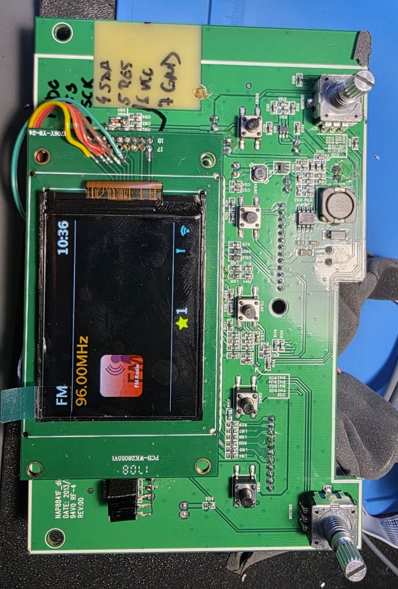
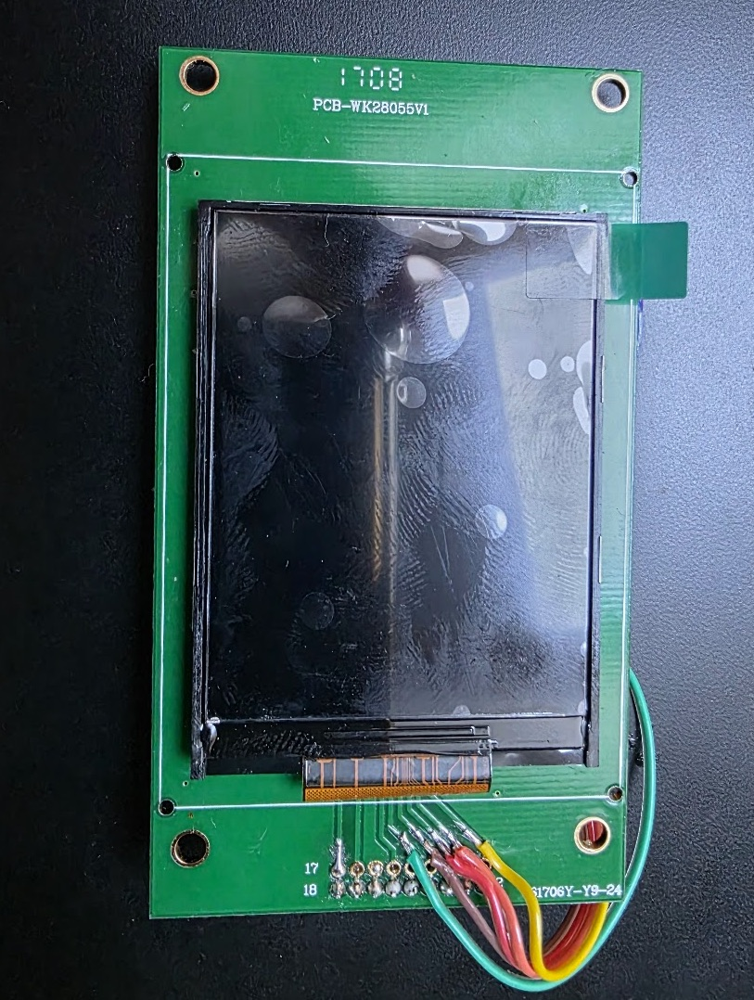
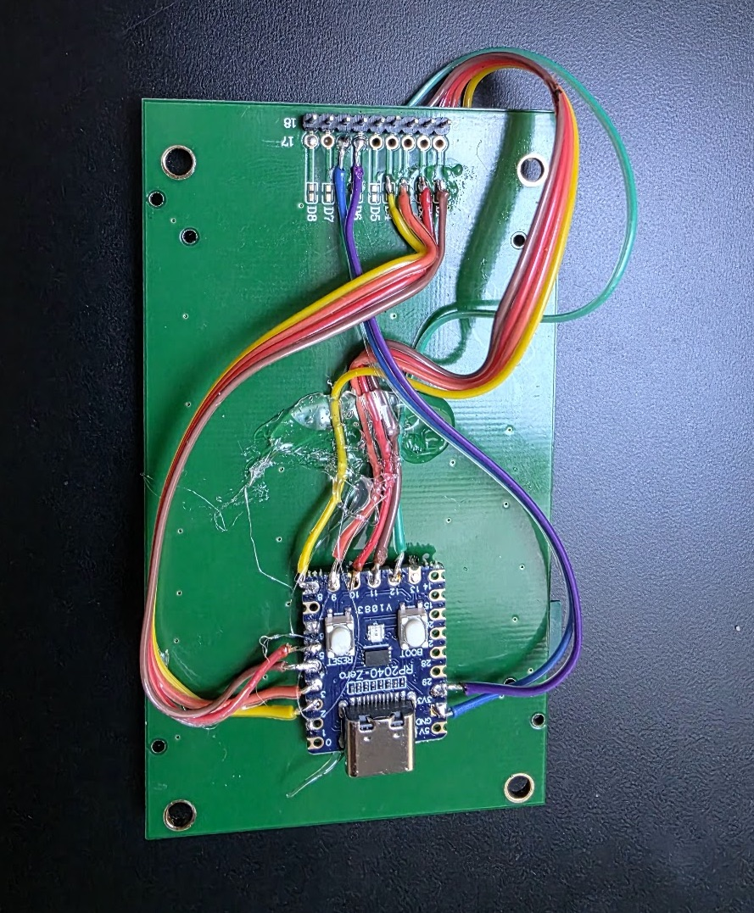

# HX8347 → ST7789 / ILI9341 display converter

> 🇵🇱 Polska wersja: [README_PL.md](README_PL.md)

Manual for an adapter built on a **Raspberry Pi Pico** or **RP2040-Zero**, for internet radios based on the **Frontier Silicon Venice 6.5** module (tested: Numan One, Auna Connect 150).

---

## 1. What it is for

The firmware of these radios drives the display as if it had a **HX8347** controller (an old Himax controller that is hardly available today). Cheap, easy-to-find 2.4″ and 2.8″ 240×320 panels use an **ST7789** or **ILI9341** controller, which understands different commands. Connected directly to the radio they show a **white screen**.

The converter:

1. **listens** to the radio's transmission to the display (in hardware, using PIO, without loading the lines),
2. **translates** HX8347 commands to ST7789/ILI9341:

   | Radio (HX8347) | Panel (ST7789 / ILI9341) |
   |---|---|
   | registers `02`–`05` (window, columns) | `2A` CASET |
   | registers `06`–`09` (window, rows) | `2B` RASET |
   | register `22` (write image) | `2C` RAMWR + pixels unchanged (RGB565) |
   | register `16` (orientation) | `36` MADCTL |
   | register `28` (display on) | `29` / `28` |

**3.** **initialises the panel by itself** at power-up (the HX8347 initialisation sent by the radio is ignored),

**4.** sends the image to the panel over its own fast SPI (31 MHz).

---

## 2. What you need

- a **Raspberry Pi Pico** or **RP2040-Zero** board (Waveshare or a clone),
- a **240×320 TFT panel, 4-wire SPI (with a D/C line)**, **ST7789** or **ILI9341** controller, e.g. 2.8″ or 2.4″ with a 10-pin flex cable,
- thin wire (enamelled wire works best), soldering iron, flux.

---

## 3. Flashing the firmware

Repository layout:

| Path | Contents |
|---|---|
| `bin/hx2st_PICO.uf2` | ready-to-flash firmware for the Raspberry Pi Pico |
| `bin/hx2st_RP2040-ZERO.uf2` | ready-to-flash firmware for the RP2040-Zero |
| `firmware/hx2st_pico/hx2st_pico.ino` | source code (Arduino) |
| `docs/` | this manual as PDF (English and Polish) |

**Flashing without Arduino IDE:**

1. Hold the **BOOT** button (on the Pico: **BOOTSEL**).
2. While holding it, connect the board to the computer with a USB cable, then release the button.
3. A drive called **RPI-RP2** appears.
4. Drag the matching `.uf2` file onto it. The board restarts by itself and runs the program.

If the drive does not appear, try another cable. Some USB-C cables are charge-only.

**Building from source (optional):** Arduino IDE with the *"Raspberry Pi Pico/RP2040/RP2350" (Earle F. Philhower)* core, board *Raspberry Pi Pico* or *Waveshare RP2040 Zero*, **CPU Speed: 250 MHz (Overclock)**.

---

## 4. Wiring

### 4.1 From the radio to the converter (inputs)

| Radio line | Pico / RP2040-Zero |
|---|---|
| **SDA** (data) | **GP2** |
| **SCK** (clock) | **GP3** |
| **D/C** (RS, command/data) | **GP4** |
| **CS** (display select) | **GP5** |
| **GND** | **GND** |

> **⚠ Important: take the signals directly at the Venice module, BEFORE the series resistors** (in the Numan One: 3.3 kΩ on each line). After the resistors, over a long flex cable and wires, the clock pulses (about 5 MHz, about 100 ns) fade and the converter loses data.
>
> The correct end of the resistor is the one with **about 0 Ω** to the module pin (check with a multimeter, radio switched off).

Do not connect the radio's **RESET** line; the converter does not use it.

### 4.2 From the converter to the panel (outputs)

| Pico / RP2040-Zero | Panel | Pin no. (10-pin flex) | Pin no. (Auna, 9-pin header) |
|---|---|---|---|
| **GP8** | RS / D/C | 2 | 1 |
| **GP9** | CS | 3 | 2 |
| **GP10** | SCL (clock) | 4 | 3 |
| **GP11** | SDA (data) | 5 | 4 |
| **GP12** | RESET | 6 | 5 |
| **3V3** | VCC | 7 | 6 |
| **GND** | GND | 1 and 8 | 7 |
| *(from the radio, as before)* | A (LED+) | 9 | 8 |
| *(from the radio, as before)* | K (LED−) | 10 | 9 |

10-pin flex cable pinout. The original HX8347 panels of these radios (Numan One/Two) and cheap ST7789 replacements share it:

```
 1 GND   2 RS(D/C)   3 CS   4 SCL   5 SDA   6 RESET   7 VCC   8 GND   9 A(LED+)   10 K(LED-)
```

In the **Auna Connect 150** the display board plugs into the radio with a **9-pin** header. The pinout is the same as the 10-pin flex, just without the first GND pin:

```
 1 RS(D/C)   2 CS   3 SCL   4 SDA   5 RESET   6 VCC   7 GND   8 A(LED+)   9 K(LED-)
```

> **⚠ The panel may receive signals from one source only: the converter.** If the old path from the radio still reaches the panel connector, cut it: remove the series resistors or cut the traces after the tap point.

### 4.3 Power

- **Permanent:** from the radio. On the **Pico**: 3.3–5 V to the **VSYS** pin. On the **RP2040-Zero**: 5 V to the **5V** pin or 3.3 V to the **3V3** pin. Radio and converter grounds must be connected.
- **For diagnostics:** from the computer's USB.
- Do not power the board from the radio's 5 V and USB at the same time.

### 4.4 Configuration jumpers

Read **once, at power-up** (restart the board after a change). A jumper connects the pin **to GND**.

| Pin | Open (nothing) | Connected to GND |
|---|---|---|
| **GP6** | **ST7789** panel | **ILI9341** panel |
| **GP7** | normal image | image **rotated 180°** |
| **GP13** | normal colours | **inverted** colours (IPS panels: white instead of black) |

Tested settings:

| Radio | Panel | GP6 | GP7 | GP13 |
|---|---|---|---|---|
| Numan One | 2.8″ ST7789 (TN, 10-pin) | – | – | – |
| Auna Connect 150 | 2.4″ ST7789V IPS (10-pin flex) | – | GND | GND |
| Numan One | ILI9341 (SPI module) | GND | – | – |

### 4.5 Diagram

```
  RADIO (at the Venice module,     CONVERTER                 PANEL
         BEFORE the resistors)     Pico / RP2040-Zero        ST7789 / ILI9341

  SDA ---------------------------> GP2        GP8  -------> RS (D/C)
  SCK ---------------------------> GP3        GP9  -------> CS
  D/C ---------------------------> GP4        GP10 -------> SCL
  CS  ---------------------------> GP5        GP11 -------> SDA
  GND ---------------------------> GND        GP12 -------> RESET
  5V or 3.3V --------------------> 5V / VSYS  3V3  -------> VCC
                                              GND  -------> GND
                                   GP6, GP7, GP13 -> jumpers to GND
  backlight LED+/LED- ------------------------------------> A / K
```

### 4.6 Example build: Auna Connect 150

- **Panel:** 2.4″ 240×320 ST7789V IPS with a **10-pin** flex cable, same pinout as the original. Bought as a module sold as "2.4 inch TFT LCD 240x320 SPI 8 pin ST7789V": a blue **GMT024-08-SPI8P** board with an 8-pin header (GND VCC SCL SDA RST DC CS BL) and a 10-pin FPC connector on the back. The "8 pin" in the name is the board header, not the panel flex. The panel was peeled off that board and its flex soldered in place of the original panel on the radio's display board (PCB-WK28055V1).
- **Converter:** RP2040-Zero glued to the back of the display board and wired in series. The traces between the 9-pin header (from the radio) and the panel are cut. The header goes to inputs GP2–GP5, outputs GP8–GP12 go to the panel pads.
- **Power** from the radio (VCC and GND from the header).
- **Jumpers:** GP7 and GP13 to GND (180° rotation and inverted colours for the IPS panel).







---

## 5. Start-up: what to expect

1. At power-up the converter initialises the panel and draws a **dark blue screen with a white bar**. This confirms that the converter → panel connection works.
2. About 1–2 s after the radio is switched on, its bootloader sends the **boot logo**. It is drawn **slowly, about 1.3 s**, because that is how the radio sends it.
3. After about 20–30 s the radio application starts and the **user interface** appears.

The Numan refreshes the screen about 60 times per second, the Auna only when something on the screen changes.

---

## 6. USB diagnostics

Connect the board to a computer and open the serial port at **115200**: Arduino IDE Serial Monitor, CoolTerm, or in a macOS terminal:

```
ls /dev/cu.usbmodem*
screen /dev/cu.usbmodemXXXX 115200      (exit: Ctrl+A, K, Y)
```

Every second a line like this appears (field names are printed in Polish):

```
ST7789 obrot180 | CPU 250 MHz | bajty 305198 komendy 441 obrazy 63 piksele(B) 304379 | zle 0 przepelnienia 0 | okno 232..239 x 0..319 | rej16=08
```

| Field | Meaning | Expected |
|---|---|---|
| start | panel type and active jumpers (`obrot180` = rotated 180°, `inwersja` = inverted) | as configured |
| bajty (bytes) | bytes received from the radio in the last second | > 0 while the radio draws |
| komendy (commands) | commands (D/C = 0) | > 0 while the radio draws |
| obrazy (images) | number of image writes (register `22`) | > 0 while the radio draws |
| piksele(B) (pixel bytes) | pixel bytes passed to the panel | ≈ bytes |
| **zle** (bad) | bytes with wrong clock timing (total since start) | **0** |
| **przepelnienia** (overflows) | buffer overflows (total) | **0** |
| okno (window) | last window set by the radio | within 0..239 × 0..319 |
| rej16 (reg16) | orientation sent by the radio | usually `08` |

Statistics are sent only while the port is open on the computer.

---

## 7. Troubleshooting

| Symptom | Cause / fix |
|---|---|
| No blue start-up screen | Converter → panel connection (GP8–GP12, VCC, GND), board power, backlight. For an ILI9341 panel, connect GP6 to GND. |
| Blue screen stays, "bajty 0" | The radio sends nothing (switched off, no Venice module, still booting, Auna with nothing changing on screen) or CS/SCK do not arrive. Check GP2–GP5 and ground. |
| Noise, torn image, "zle" > 0 | Clock pulses are lost: tap after the resistors or wires too long. Move the tap before the resistors, shorten the wires, improve ground. |
| Image upside down | Jumper **GP7** to GND. |
| Mirrored image (only left–right or top–bottom) | Change the `MADCTL_XOR_ST7789` / `MADCTL_XOR_ILI9341` constant in the code: bit `0x80` flips horizontally (text reads right to left), bit `0x40` vertically. |
| Negative (white instead of black) | Jumper **GP13** to GND (IPS panel). |
| Red ↔ blue swapped | Toggle bit `0x08` in `MADCTL_XOR_…` in the code. |
| Only the boot logo stays on screen; statistics show 64 commands and about 153 KB of pixels every dozen or so seconds | **The radio keeps rebooting** (a radio problem, not the converter): faulty Venice module or firmware not matching the hardware. |
| White screen after plugging in USB while the radio is running | The board restarted on the power change. The panel got a new initialisation, but the radio has not sent a new image yet. Restart the radio. |

---

## 8. Technical details

- Input: RP2040 PIO, bit sampled on the rising edge of SCK, only while CS = 0 (traffic with CS = 1, e.g. the module's flash memory reads on the same bus, is ignored). D/C is captured with the first bit of each byte.
- Resynchronisation: the Numan keeps CS active all the time, so CS does not align the bytes. After every pause in the transfer longer than 0.3 ms (end of an image strip) the receiver restarts bit counting. This lets the converter be powered on or restarted while the radio is running.
- Input buffer: 8192 bytes (DMA, 32 KB ring), about 13–27 ms of headroom.
- Output: hardware SPI1, 31.25 MHz, mode 0. Panel CS/DC driven by the CPU.
- Measured in the Numan One: radio clock about 5 MHz (about 100 ns / 96 ns), about 300 KB/s, 0 errors.
- CPU clock: 250 MHz.
- HX8347 initialisation sequences captured from the radios (for comparison):
    - Numan One: `18=99 19=01 1B=1E 1C=02 1A=02 24=3F 25=47 23=70 …`
    - Auna Connect 150: `18=88 19=01 1B=1E 1C=02 1A=01 24=38 25=5F 23=68 …`
    - the rest (E2–EB, 1F, gamma 40–5D, 36=00, 17=05, 16=08, window 02–09, 22, 28=38/3C) is identical.

---

## License and disclaimer

Released under the [MIT License](LICENSE).

This is an independent hobby project, not affiliated with or endorsed by Frontier Smart Technologies, Numan, Auna or any other manufacturer. Product names are used only to describe compatibility. You modify your radio at your own risk.

Reports from other radios (model, firmware version, panel, jumper settings) are welcome as GitHub issues.
